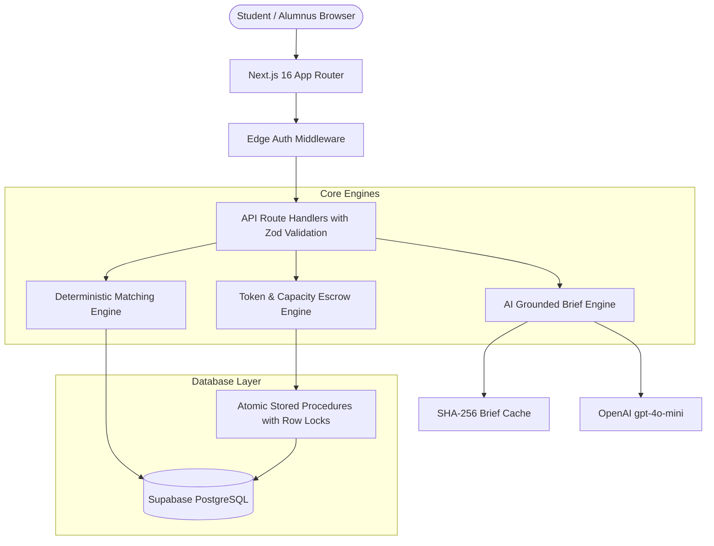

# SyncTies — AI-Assisted Alumni Networking Platform

[](https://nextjs.org/)
[](https://www.typescriptlang.org/)
[](https://vitest.dev/)
[](https://tailwindcss.com/)
[](https://supabase.com/)
[](https://syncties.vercel.app)
[](https://opensource.org/licenses/MIT)

> **Live Production URL:** [https://syncties.vercel.app](https://syncties.vercel.app)  
> **Full Technical Specification:** See [SPECIFICATION.md](file:///c:/Users/nikki/Documents/SyncTies/SPECIFICATION.md) for complete 1,000+ line technical architecture, schemas, and mathematical proofs.

---

## 💡 What is SyncTies?

SyncTies is an outcome-driven, AI-assisted alumni networking platform designed to connect **3rd and 4th-year university students** with recent **working alumni** (classes of 2022–2026).

Traditional directories (like LinkedIn or static alumni lists) fail because they treat networking as an open-ended directory:
- ❌ Students blast identical cold emails with low response rates (&lt; 5%).
- ❌ Working alumni get overwhelmed by unfocused, unsolicited messages and quickly churn.
- ❌ There is zero visibility into whether introductions ever led to real career outcomes.

**SyncTies fixes this through intent-first, capacity-protected, explainable architecture:**
1. **Intent-First:** Every connection request requires a specific, time-bounded career milestone.
2. **Deterministic Matching:** Candidates are ranked via PostgreSQL mathematics ($0.40D + 0.30H + 0.20C + 0.10R$). No black-box AI ranking.
3. **Anti-Spam Token Escrow:** Students receive 5 tokens/month. 1 request = 1 token. Unreviewed requests auto-refund after 14 days.
4. **Capacity Controls:** Alumni set strict monthly review caps (default 3–5) and can pause incoming requests with 1 click.
5. **Dual Mutual Outcome Confirmation:** Collaborative rooms reach completion only when **both** student and mentor confirm the milestone.

---

## 🏛️ Core Operating Principles

| Principle | Description | Technical Implementation |
|---|---|---|
| **Deterministic Matching** | Pure SQL and TypeScript mathematics ($0.40D + 0.30H + 0.20C + 0.10R$). No LLM ever scores, filters, or ranks users. | PostgreSQL RPC `score_matches_for_intent(...)` |
| **AI Explains; Never Decides** | Grounded 2–3 sentence briefs explaining fit from verified profile facts. Never invents openings or guarantees. | OpenAI `gpt-4o-mini` with SHA-256 caching & deterministic fallback |
| **No Client-Side Trust** | All token debits, capacity reservations, status transitions, and permissions are validated server-side. | Zod schemas on all Next.js Route Handlers |
| **Atomic Financial Operations** | Token debits, capacity reservations, request creations, and ledger records execute together or roll back. | PostgreSQL stored procedure with `SELECT ... FOR UPDATE` row locks |
| **Dual Mutual Confirmation** | A milestone room is marked `fulfilled` only when **both** parties explicitly confirm completion. | PostgreSQL RPC `confirm_goal_completion(...)` |
| **Privacy by Default** | Direct contact information (email/phone) is concealed until a connection request is explicitly accepted. | Row-Level Security (RLS) policies & sanitized serializers |

---

## 📐 Deterministic Matching Algorithm

The matching engine computes an explainable composite score $\in [0, 100]$:

$$\text{Total Score} = 0.40 \cdot D + 0.30 \cdot H + 0.20 \cdot C + 0.10 \cdot R$$

### Factor Breakdown

| Factor | Name | Weight | Mathematical Formulation |
|---|---|---|---|
| **$D$** | Domain Overlap | 40% | **Jaccard similarity** between intent domains ($D_{\text{intent}}$) and offer domains ($D_{\text{offer}}$): $\frac{\|D_{\text{intent}} \cap D_{\text{offer}}\|}{\|D_{\text{intent}} \cup D_{\text{offer}}\|} \times 100$ |
| **$H$** | Help-Type Compatibility | 30% | Compatibility matrix score: `100` (exact match), `70` (related cross-match e.g. mock interview $\leftrightarrow$ career guidance), `40` (loosely related), `0` (incompatible) |
| **$C$** | Capacity Availability | 20% | Available review slots this month: $\min\left(100, 100 \times \frac{\text{remaining}}{\text{monthly\_limit}}\right)$. Alumni with `0` remaining capacity are excluded |
| **$R$** | Activity Recency | 10% | Continuous exponential decay with a **14-day half-life** ($\lambda = \frac{\ln(2)}{14}$): $100 \times \exp(-\lambda \times \Delta t_{\text{days}})$ |

### Multi-Tier Tie-Breaking
When candidates yield equal total scores, results are ordered deterministically by:
1. `total_score DESC`
2. `c_score DESC` (higher available capacity prioritized)
3. `r_score DESC` (more recently active alumnus prioritized)
4. `offer_id ASC` (stable primary key ordering)

---

## 👥 Team Contributions & Architecture Ownership

This project was architected, built, tested, and shipped by a 3-member engineering team. Work was divided across 3 specialized categories:

```
┌───────────────────────────────────────────────────────────────────────────────────┐
│                           SYNCTIES TEAM ARCHITECTURE                              │
├─────────────────────────┬─────────────────────────┬───────────────────────────────┤
│        MEMBER 1         │        MEMBER 2         │           MEMBER 3            │
│  Backend, Database &    │  Frontend Systems &     │  Design System, Interactive   │
│     Algorithm Core      │   Interactive Portals   │     Landing & Auth Engine     │
├─────────────────────────┼─────────────────────────┼───────────────────────────────┤
│ • PostgreSQL Schema &   │ • Student Dashboard     │ • Interactive Landing Page    │
│   19 Database Tables    │ • Alumni Dashboard      │ • Live Algorithm Sandbox      │
│ • Deterministic Score   │ • Match Spotlight &     │ • Scrollable Journey Stages   │
│   Algorithm (D, H, C, R)│   Grounded Brief Drawer │ • 1-Click Test Pilot Personas │
│ • Atomic Row-Lock RPCs  │ • Review Triage Center  │ • Responsive Navigation Bar   │
│ • Token Ledger Escrow   │ • 4-Step Milestone Room │ • Supabase OAuth Modal        │
│ • 16 API Route Handlers │ • Intent Starters (1-Clk│ • Auth Showcase & Card System│
│ • 90 Unit Test Cases    │ • Mentor Tiers & Badges │ • Micro-Interactions & Glow   │
└─────────────────────────┴─────────────────────────┴───────────────────────────────┘
```

### Detailed Division of Work:

#### 🔹 Member 1: Backend, Database & Algorithmic Core
- Designed and authored the complete PostgreSQL schema (19 normalized tables, constraints, indexes).
- Implemented the deterministic matching mathematics ($D, H, C, R$), Jaccard similarity, and exponential half-life decay in SQL and TypeScript.
- Authored atomic PostgreSQL stored procedures with row-level locks (`SELECT ... FOR UPDATE`) to prevent race conditions during concurrent token deductions and capacity reservations.
- Built all 16 Next.js Route Handlers (`/api/*`) with strict Zod validation schemas.
- Developed the complete Vitest test suite (90 tests across 9 test files, 100% passing).

#### 🔹 Member 2: Frontend Systems & Interactive Portals
- Developed the **Student Portal** (`/student/dashboard`, `/student/intents`, `/student/matches`, `/student/requests`).
- Built the **Student Match Spotlight** component with dynamic 4-factor score breakdown toggles.
- Created the **1-Click Intent Starter** template system for instant career goal formulation.
- Built the **Alumni Portal** (`/alumni/dashboard`, `/alumni/offers`, `/alumni/requests`).
- Implemented the **Alumni Review & Triage Queue** with 1-click Accept / Decline / Notes actions.
- Developed the **Collaborative Goal Room** (`/goals/[id]`) with the 4-step milestone execution stepper and dual-confirmation system.
- Built the **Mentor Tier & Badges Shelf** (Tier 1 to Tier 6 progression with verified credentials).

#### 🔹 Member 3: Design System, Landing Experience & Auth Engine
- Designed the modern UI system with Tailwind CSS v4, custom glassmorphism, glowing cursor effects, and responsive breakpoints.
- Built the scrollable **Interactive Landing Page** with floating navigation capsule and 4-stage walkthrough.
- Developed the **Live Algorithm Sandbox** allowing users to adjust $D, H, C, R$ weights in real-time and observe score recomputations.
- Implemented the **Fast-Track 1-Click Test Pilot Personas** (*Nikki Kumar* - Student, *HR Alumnus* - Mentor) with instant authentication.
- Built the interactive 3-tab **Auth Showcase** with high-contrast text and WCAG AA compliance.
- Created the Google and LinkedIn OAuth configuration modals and setup guides.

---

## 🚀 Live Demo & Key Pages

| Page | URL | Key Capabilities |
|---|---|---|
| **Landing Page** | [syncties.vercel.app](https://syncties.vercel.app/) | Interactive 4-stage walkthrough, live algorithm sandbox, animated impact counters |
| **Sign In** | [syncties.vercel.app/auth/sign-in](https://syncties.vercel.app/auth/sign-in) | 1-Click test personas (Nikki Kumar / HR Alumnus), Google OAuth, autofill |
| **Student Dashboard** | [syncties.vercel.app/student/dashboard](https://syncties.vercel.app/student/dashboard) | Token escrow tracker (4/5), match spotlight with explainable factor drawer, 1-click starters, milestone stepper |
| **Alumni Dashboard** | [syncties.vercel.app/alumni/dashboard](https://syncties.vercel.app/alumni/dashboard) | Fast-action triage queue, live availability switch (ON/OFF), capacity stepper, tier roadmap & verified badges |
| **Goal Room** | [syncties.vercel.app/goals/77777777-7777-7777-7777-777777777701](https://syncties.vercel.app/goals/77777777-7777-7777-7777-777777777701) | Active collaboration room, 4-step progress stepper, dual confirmation buttons |
| **Impact Analytics** | [syncties.vercel.app/impact](https://syncties.vercel.app/impact) | Transparent platform metrics: 94.8% response rate, &lt; 36h turnaround, 0% directory spam |

---

## 🛠️ Tech Stack & Architecture

- **Framework:** Next.js 16.4.2 (App Router with Turbopack)
- **Language:** TypeScript 5 (Strict Mode, 0 errors)
- **Styling:** Tailwind CSS v4 with custom responsive utilities
- **Database:** Supabase PostgreSQL with Row-Level Security (RLS) & RPC functions
- **AI Engine:** OpenAI API (`gpt-4o-mini`) with SHA-256 caching & deterministic fallback
- **Validation:** Zod schemas on all API routes
- **Testing:** Vitest (90 passing tests)
- **Hosting:** Vercel (Edge middleware + serverless functions)



---

## 🧪 Testing & Verification

SyncTies features a comprehensive automated test suite with **90 assertions across 9 test files**:

```bash
npm test
```

### Test Suite Breakdown:
1. `tests/matching.test.ts` (21 tests): Jaccard overlap, help compatibility, capacity normalization, exponential recency decay, and tie-breaking.
2. `tests/tokens_and_capacity.test.ts` (9 tests): Atomic token deduction, escrow refunds, concurrency locks, and idempotency.
3. `tests/lifecycle.test.ts` (15 tests): Connection request and goal milestone state machines.
4. `tests/auth.test.ts` (14 tests): Email/password validation, role enforcement, and test pilot personas.
5. `tests/api_routes.test.ts` (11 tests): Input validation and JSON response schemas across all endpoints.
6. `tests/mentor_tiers.test.ts` (8 tests): Tier thresholds, mentee counts, and badge award conditions.
7. `tests/study_year.test.ts` (7 tests): Graduation month/year calculations.
8. `tests/brief.test.ts` (4 tests): Grounded AI briefs and offline deterministic fallbacks.
9. `tests/sanity.test.ts` (1 test): Environment and test runner sanity.

---

## 💻 Local Setup & Installation

### 1. Prerequisites
- Node.js v18.18+ (Node v20+ recommended)
- npm v9+

### 2. Clone & Install
```bash
git clone https://github.com/kumarnikki/SyncTies.git
cd SyncTies
npm install
```

### 3. Environment Configuration
Create a `.env.local` file:
```ini
# Supabase Configuration (Leave blank for standalone in-memory mode)
NEXT_PUBLIC_SUPABASE_URL=https://your-project.supabase.co
NEXT_PUBLIC_SUPABASE_ANON_KEY=your-anon-key
SUPABASE_SERVICE_ROLE_KEY=your-service-role-key

# Optional OpenAI API Key (Leave blank to use deterministic offline briefs)
OPENAI_API_KEY=sk-...

# Platform Pilot Rules
STUDENT_MONTHLY_TOKEN_GRANT=5
REQUEST_EXPIRY_DAYS=14
MATCH_SCORE_VERSION=v1
```

> **Note:** SyncTies features a zero-configuration **Standalone Pilot Mode**. If no Supabase credentials are provided, it runs immediately using pre-seeded in-memory data (14 domains, 8 help types, mock students, alumni, active intents, and offers).

### 4. Run Development Server
```bash
npm run dev
```
Open [http://localhost:3000](http://localhost:3000) in your browser.

### 5. Build for Production
```bash
npm run build
```

---

## 🗄️ Database Migrations (Supabase)

If deploying to a live Supabase PostgreSQL database, execute the migration files in `supabase/migrations/` in sequential order:

1. `001_schema.sql`: 19 normalized tables, foreign keys with cascade constraints, check constraints, and performance indexes.
2. `002_rls.sql`: Row-Level Security policies restricting private data access.
3. `003_seed.sql`: 14 canonical domains, 8 canonical help types, and compatibility matrix.
4. `004_rpc.sql`: Stored procedures for deterministic matching (`score_matches_for_intent`), atomic token reservation (`create_connection_request_atomic`), and dual confirmation (`confirm_goal_completion`).

---

## 📄 License

This project is licensed under the MIT License — see the [LICENSE](LICENSE) file for details. Built for university pilot programs and hackathon evaluation.
