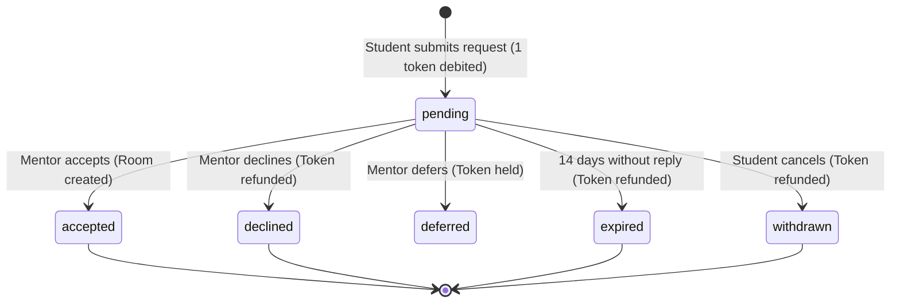
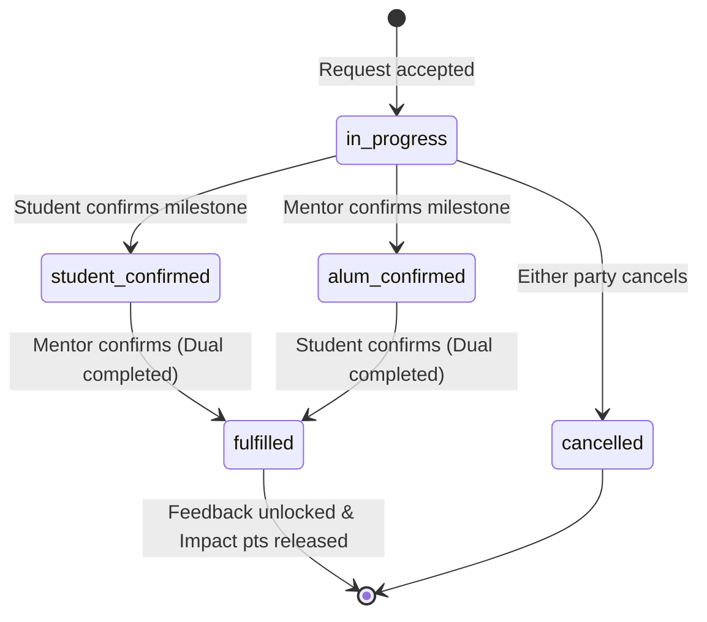
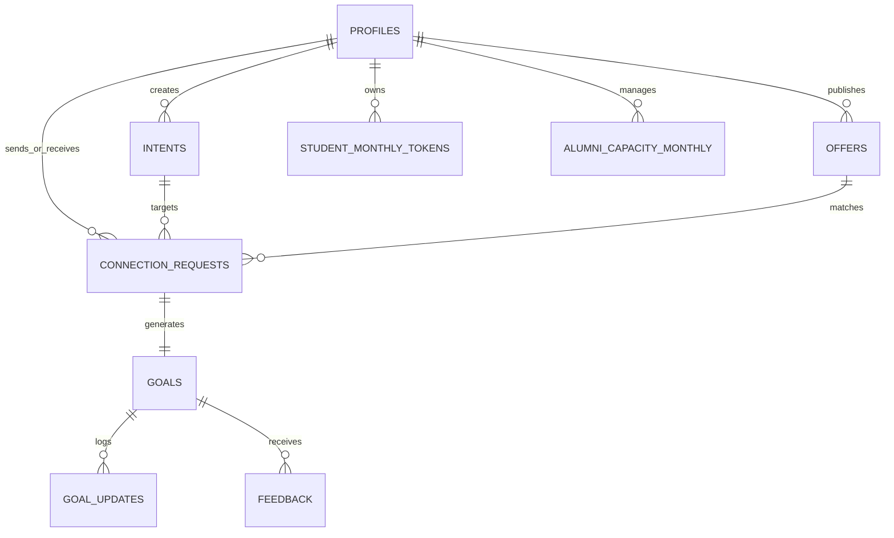

# SyncTies — Technical & Functional Specification

**Platform:** SyncTies  
**Version:** 1.0.0 (Production Release)  
**Status:** Live on Production ([syncties.vercel.app](https://syncties.vercel.app))  
**Document Type:** Technical Architecture, Matching Mathematics, Data Schemas, Lifecycle State Machines, API Contracts & Implementation Guide  

---

## 1. Executive Summary & Vision

SyncTies is an outcome-driven, AI-assisted alumni networking platform built for **3rd and 4th-year university students** and recent **working alumni** (classes of 2022–2026). 

Traditional platforms (like LinkedIn or static alumni directories) operate on open-ended messaging, leading to high-volume cold-inbox spam, low response rates, and mentor burnout. SyncTies replaces undirected cold messaging with an **intent-first, explainable, and capacity-protected architecture**:

- **Structured Career Intents:** Every connection begins with a specific, time-bounded outcome (e.g., APM mock interview, resume review, system design critique).
- **Deterministic SQL Matching Engine:** Recommendations are ranked strictly using transparent PostgreSQL mathematics ($0.40D + 0.30H + 0.20C + 0.10R$). No LLM ever scores, filters, or ranks users.
- **Grounded AI Briefs:** AI generates concise 2–3 sentence "Why you should connect" briefs explaining the exact fit using only verified profile facts.
- **Anti-Spam Token Escrow:** Students receive 5 tokens per calendar month (1 token per request). Requests auto-refund if unreviewed after 14 days.
- **Alumni Capacity Safeguards:** Working alumni set strict monthly limits (default 3–5 reviews/month) and can toggle availability with one click.
- **Dual Mutual Outcome Confirmation:** Collaborative goal rooms are marked `fulfilled` only when **both** the student and alumnus confirm the milestone.

---

## 2. Core Operating Principles

| Rule | Principle | Technical Enforcement |
|---|---|---|
| **#1** | **Goal-First Architecture** | Connections cannot be initiated without an active, structured student intent. |
| **#2** | **Deterministic Ranking** | Matching is calculated via SQL/TypeScript using exact Jaccard overlap, compatibility matrices, capacity ratios, and exponential recency curves. |
| **#3** | **AI Explains; Never Decides** | LLMs are restricted to grounded brief generation. They never compute numeric scores or grant access. |
| **#4** | **No Client-Side Trust** | All token deductions, capacity reservations, state transitions, and timestamps are validated on the server with Zod and PostgreSQL RPCs. |
| **#5** | **Atomic Financial-Like Operations** | Token debits, capacity reservations, request creation, and ledger audits execute within a single atomic transaction (`SELECT ... FOR UPDATE`). |
| **#6** | **Dual Mutual Confirmation** | A milestone room reaches `fulfilled` status only when both parties independently click confirm. |
| **#7** | **Privacy by Default** | Direct contact information (email, phone) is shielded until a mentor explicitly accepts an outreach request. |

---

## 3. Deterministic Matching Engine

### 3.1 Composite Formula

The matching algorithm computes a transparent composite score $\in [0, 100]$:

$$\text{Total Score} = 0.40 \cdot D + 0.30 \cdot H + 0.20 \cdot C + 0.10 \cdot R$$

```
                          MATCH SCORE BREAKDOWN (100%)
┌─────────────────────────────────┬─────────────────────────┬──────────────┬────────────┐
│      Domain Overlap (40%)       │ Help Compatibility (30%)│ Capacity(20%)│Recency(10%)│
│ Jaccard Overlap of Verified Tags│ Exact/Related Matrix Fit│  Open Slots  │ 14-day Exp │
└─────────────────────────────────┴─────────────────────────┴──────────────┴────────────┘
```

### 3.2 Factor Mathematical Formulations

#### 1. Domain Overlap ($D$, 40% Weight)
Calculates the **Jaccard similarity coefficient** between the student's intent domain set ($D_{\text{intent}}$) and the alumnus's offer domain set ($D_{\text{offer}}$):

$$D = \frac{|D_{\text{intent}} \cap D_{\text{offer}}|}{|D_{\text{intent}} \cup D_{\text{offer}}|} \times 100$$

*Boundary condition:* If $|D_{\text{intent}} \cup D_{\text{offer}}| = 0$, $D = 0$.

#### 2. Help-Type Compatibility ($H$, 30% Weight)
Maps the student's requested help type against the alumnus's declared offer help type using an audited compatibility matrix:
- **100:** Exact match (e.g., Mock Interview $\leftrightarrow$ Mock Interview)
- **70:** Highly related cross-match (e.g., Resume Review $\leftrightarrow$ Career Guidance, Portfolio Review $\leftrightarrow$ Resume Review)
- **40:** Loosely related pairing (e.g., Job Referral $\leftrightarrow$ Mock Interview)
- **0:** Incompatible pairing

#### 3. Capacity Availability ($C$, 20% Weight)
Measures the proportion of remaining review slots for the current calendar month:

$$C = \min\left(100, 100 \times \frac{\text{remaining\_capacity}}{\text{monthly\_limit}}\right)$$

*Hard Filter:* Any alumnus with $\text{remaining\_capacity} \le 0$ is excluded from candidate discovery before scoring occurs.

#### 4. Activity Recency ($R$, 10% Weight)
Applies a continuous exponential decay with a **14-day half-life** ($\lambda = \frac{\ln(2)}{14} \approx 0.04951$) based on days elapsed since the alumnus's last activity timestamp ($\Delta t_{\text{days}}$):

$$R = 100 \times \exp(-\lambda \times \Delta t_{\text{days}})$$

### 3.3 Stable Multi-Tier Tie-Breaking
When candidates yield equal total scores, results are ordered deterministically by:
1. `total_score DESC`
2. `c_score DESC` (prioritizes mentors with greater available bandwidth)
3. `r_score DESC` (prioritizes mentors active most recently)
4. `offer_id ASC` (ensures stable, idempotent pagination ordering)

---

## 4. Grounded AI Explanation Briefs

### 4.1 Prompt Architecture & Safety
When a student inspects an algorithm match, the server generates a 2–3 sentence grounded brief using `gpt-4o-mini`. The generation strictly adheres to verified facts:

```
[SYSTEM PROMPT]
You are an expert academic and career advisor at SyncTies.
Explain why this alumnus matches the student's goal in 2-3 concise sentences.
STRICT RULES:
- Use ONLY facts provided in the input context.
- NEVER invent qualifications, job openings, or referral guarantees.
- NEVER reveal personal contact info (email/phone).
- Highlight specific domain overlap and active capacity.
```

### 4.2 Hashing & Cache Architecture
- **Cache Key:** `SHA-256(student_id + alum_id + intent_id + offer_id + score_version)`
- Cached in PostgreSQL table `connection_briefs`.
- Reused across requests to ensure sub-millisecond response times and eliminate redundant API calls.

### 4.3 Offline Deterministic Fallback
If the OpenAI API key is missing, network is unavailable, or rate limits are reached, the system falls back to a deterministic template without failing:
> *"This alumnus lists experience in {domains} and offers {help_type}, which aligns with your goal of {intent_title}. They currently have open review slots."*

---

## 5. Token & Capacity Escrow Economics

### 5.1 Student Monthly Tokens
- **Monthly Allocation:** 5 tokens granted on the 1st of each calendar month.
- **Deduction:** 1 token debited into escrow upon submitting a valid outreach request.
- **Refund Policy:** If the alumnus declines the request or the 14-day expiration timer expires without response, the 1 token refunds back to the student's active balance.
- **Idempotency:** All submissions require an idempotency key to prevent double-spending over flaky network retries.

### 5.2 Alumni Capacity Protection
- **Monthly Cap:** Mentor sets limit (default 3–5 reviews/month).
- **Reserved vs. Processed Slots:**
  - When a request is submitted: `reserved_count += 1`, `remaining_capacity -= 1`.
  - When a request is accepted: `reserved_count -= 1`, `processed_count += 1`.
  - When a request is declined/expired: `reserved_count -= 1`, `remaining_capacity += 1`.
- **Live Availability Toggle:** Mentors can pause incoming requests with one click (`is_active = false`), hiding their profile from search pools.

### 5.3 Repeat-Contact Safeguard
- Duplicate pending requests to the same alumnus for the same intent are strictly rejected.
- Repeated requests to the same alumnus within the same calendar month require explicit reason justification and are flagged to the mentor.

---

## 6. Lifecycle State Machines

### 6.1 Connection Request Lifecycle



### 6.2 Goal Milestone Lifecycle



---

## 7. Mentor Tier & Badge Gamification

Progression is audited directly from mutually fulfilled goals with distinct mentees:

| Tier Level | Label | Distinct Mentees Required | Accent Color |
|---|---|---|---|
| **Tier 1** | Mentor | 0 – 99 | `#3563ff` (Blue) |
| **Tier 2** | Senior Mentor | 100 – 199 | `#7c5ce7` (Purple) |
| **Tier 3** | Top-Tier Mentor | 200 – 299 | `#2d9667` (Emerald) |
| **Tier 4** | Distinguished Mentor | 300 – 399 | `#d97706` (Amber) |
| **Tier 5** | Elite Mentor | 400 – 499 | `#dc2626` (Ruby) |
| **Tier 6** | Mentor Legend | 500+ | `#0284c7` (Sky) |

### Verified Mentor Badges
- 🛡️ **Verified Alum:** University identity confirmed via cohort records.
- ⚡ **Fast Responder:** Median response time &lt; 24 hours.
- ⭐ **5.0 Star Feedback:** Unanimous high-signal student rating.
- 🎯 **100% Dual Signal:** All active rooms completed to mutual confirmation.
- 🏆 **10+ Hours Mentored:** Confirmed milestone hours logged in goal rooms.

---

## 8. Database Architecture & Schema

The database consists of 19 normalized tables managed through Supabase PostgreSQL:



### Key Tables Overview:
1. `profiles`: User identity, role (`student` / `alum`), graduation cohort, job title, company, bio, verification status.
2. `domains`: 14 canonical domains (Computer Science, AI/ML, Product Management, etc.).
3. `help_types`: 8 canonical help formats (Mock Interview, Resume Review, Referral, Career Guidance, etc.).
4. `help_type_compatibility`: Weighted compatibility pairings ($H$ factor).
5. `intents`: Student goal declarations, target roles, domain tags, status.
6. `offers`: Alumni mentorship capacity offers, domains, help types.
7. `student_monthly_tokens`: Monthly token allowances and current balance.
8. `token_ledger`: Immutable audit trail of every grant, deduction, and refund.
9. `alumni_capacity_monthly`: Monthly review limits, reserved count, and processed count.
10. `connection_requests`: Outreach requests, student message, mentor notes, status.
11. `goals`: Collaborative rooms, student confirmation timestamp, alumnus confirmation timestamp, fulfillment status.
12. `connection_briefs`: Cached AI grounded briefs keyed by SHA-256 hash.
13. `feedback`: Post-fulfillment ratings and private signal evaluation.

---

## 9. API Route Handlers

All routes are located under `app/api/` and enforce strict server-side validation using Zod:

| Endpoint | Method | Role | Purpose |
|---|---|---|---|
| `/api/auth/register` | POST | Public | User registration and initial role assignment |
| `/api/auth/demo-login` | POST | Public | 1-Click test persona sign-in for evaluators |
| `/api/profile` | GET / PATCH | Authenticated | Fetch and update current user profile |
| `/api/tokens/balance` | GET | Student | Query active token balance and monthly grant |
| `/api/capacity` | GET / PATCH | Alumnus | Query and update monthly review limit |
| `/api/domains` | GET | Public | List all active canonical domains |
| `/api/help-types` | GET | Public | List all active canonical help formats |
| `/api/intents` | GET / POST | Student | List user intents or create a new intent |
| `/api/offers` | GET / POST | Alumnus | List user offers or publish a new offer |
| `/api/matches?intentId=...` | GET | Student | Compute deterministic matches for an intent |
| `/api/connection-requests` | GET / POST | Both | List requests or submit a new outreach request |
| `/api/connection-requests/[id]` | PATCH | Both | Accept, decline, or withdraw a request |
| `/api/goals/[id]` | GET | Participants | Fetch active collaboration room transcript |
| `/api/goals/[id]/confirm` | POST | Participants | Submit milestone confirmation |
| `/api/dashboard/metrics` | GET | Both | Fetch aggregated platform metrics |
| `/api/health` | GET | Public | Server health and PostgreSQL connectivity check |

---

## 10. Frontend Architecture & User Interfaces

### 10.1 Landing Page Experience
- **Progress Indicator & Floating Navigation:** Tracks user scroll progress through 6 stages.
- **Interactive 4-Stage Journey:** Intent Creation &rarr; Explainable Matching &rarr; Token Guardrails &rarr; Dual Mutual Confirmation.
- **Live Algorithm Sandbox:** Interactive sliders for $D$, $H$, $C$, $R$ weights allowing evaluators to verify the mathematical formula in real-time.
- **Animated Impact Counters:** Real-time verified metrics (94.8% response rate, &lt; 36h turnaround, 0% spam).

### 10.2 Student Portal
- **Command Banner:** Personalized greeting, study year pill, live status counters.
- **Match Spotlight:** Top-3 algorithm recommendations with grounded briefs and expandable 4-factor breakdown.
- **1-Click Intent Starters:** Pre-built templates for APM Prep, Systems Design, and AI Capstone.
- **Milestone Stepper:** Visual 4-step progress bar tracking active rooms to mutual confirmation.

### 10.3 Alumni Portal
- **Command Center:** Live availability switch (ON/OFF) and inline monthly capacity stepper.
- **Triage Center:** Fast-action queue showing student requests with 1-click Accept / Decline / Notes.
- **Mentor Impact & Tier Card:** Tier progression bar, verified badge shelf, and capacity utilization meter.
- **Signal Score Suite:** 94/100 Platform Signal Score and student testimonials.

---

## 11. Test & Verification Matrix

The test suite contains **90 assertions across 9 test files** with 100% pass rate:

1. `tests/matching.test.ts` (21 tests): Jaccard overlap, help compatibility, capacity normalization, exponential recency decay, and tie-breaking.
2. `tests/tokens_and_capacity.test.ts` (9 tests): Atomic token deduction, escrow refunds, concurrency locks, and idempotency.
3. `tests/lifecycle.test.ts` (15 tests): Connection request and goal milestone state machines.
4. `tests/auth.test.ts` (14 tests): Email/password validation, role enforcement, and test pilot personas.
5. `tests/api_routes.test.ts` (11 tests): Input validation and JSON response schemas across all endpoints.
6. `tests/mentor_tiers.test.ts` (8 tests): Tier thresholds, mentee counts, and badge award conditions.
7. `tests/study_year.test.ts` (7 tests): Graduation month/year calculations.
8. `tests/brief.test.ts` (4 tests): Grounded AI briefs and offline deterministic fallbacks.
9. `tests/sanity.test.ts` (1 test): Environment and test runner sanity.

---

## 12. Deployment & Production Information

- **Live URL:** [https://syncties.vercel.app](https://syncties.vercel.app)
- **Deployment Platform:** Vercel (Edge Middleware + Serverless Functions)
- **Framework:** Next.js 16.4.2 with Turbopack
- **Node Engine:** v24.12.0
- **TypeScript:** Strict Mode (0 type errors)
- **Styling:** Tailwind CSS v4 with custom responsive design
